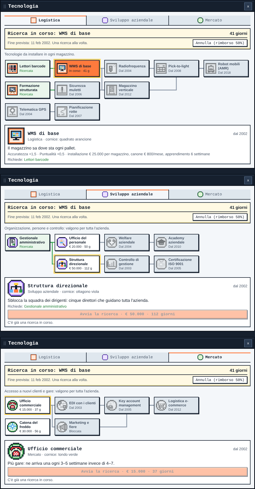

# FUP – Fino all'ultimo pallet

Gioco di strategia in pixel art sulla logistica italiana, nello stile dei grand strategy di Paradox. Sei il CEO di un'azienda di trasporti del Nord-Ovest: compri magazzini, vinci gare, assumi personale e manager, fai ricerca su tre alberi tecnologici e tieni contenti i clienti su Puntualità e Accuratezza.

**Per giocare:** apri `dist/fup.html` nel browser (desktop).

**Per sviluppare:** leggi [`CLAUDE.md`](CLAUDE.md) e [`docs/design.md`](docs/design.md).

```bash
python3 tools/build.py && python3 tests/smoke_test.py
```


